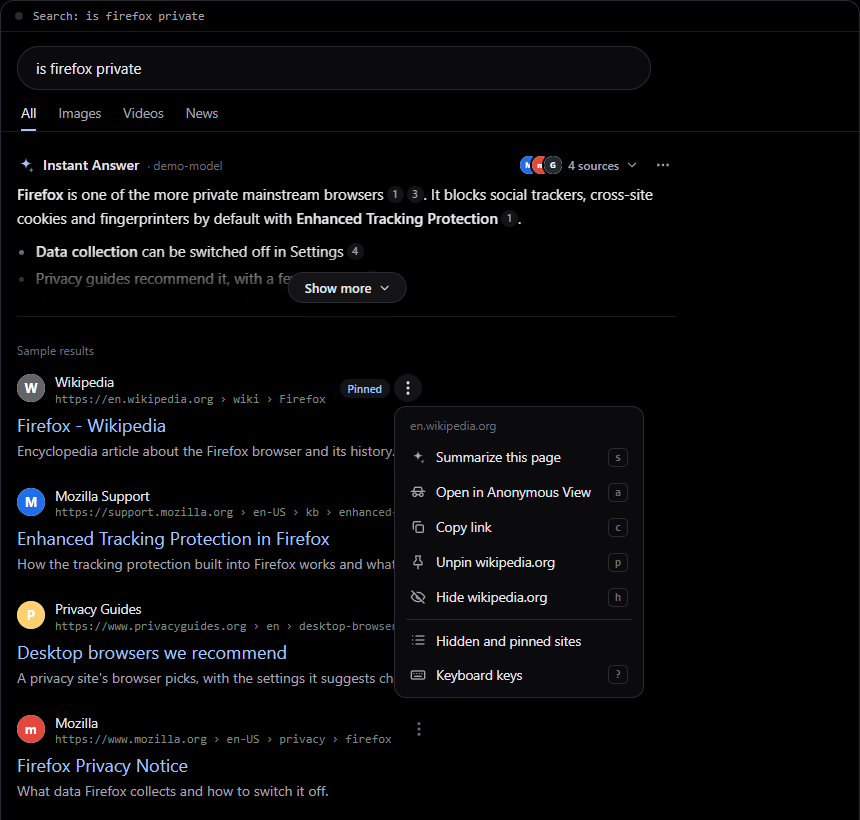
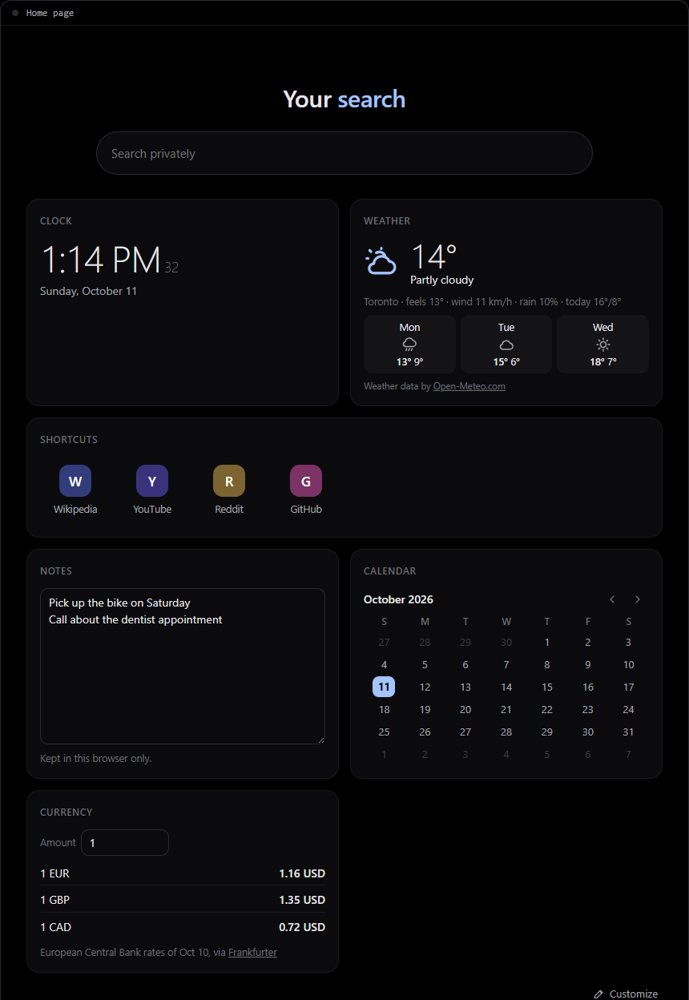
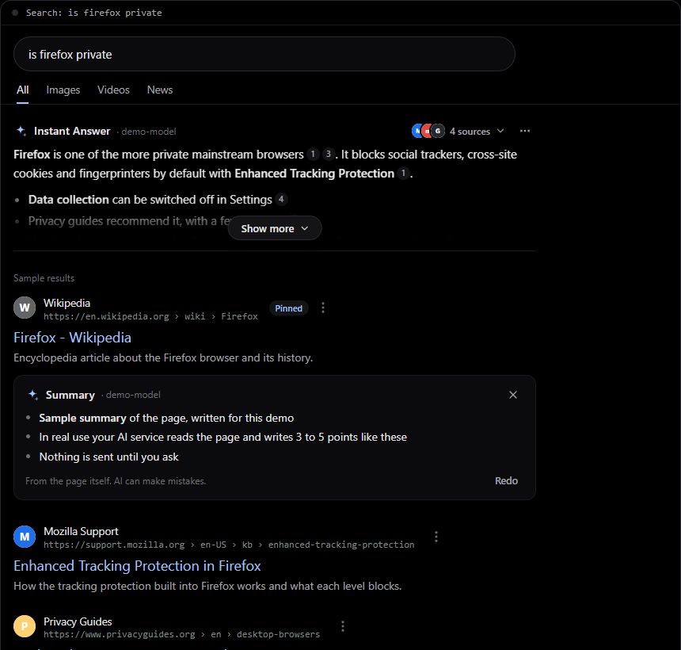
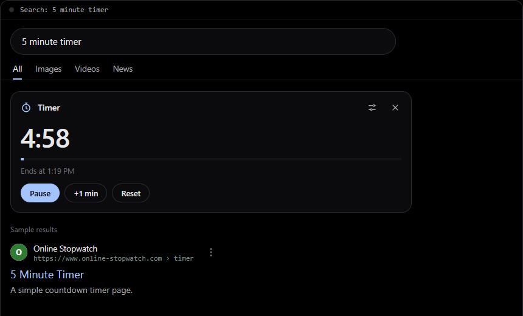
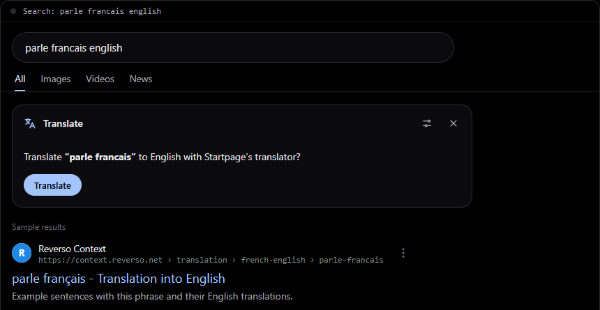

# Blackout for Startpage

A true black theme and a few small add-ons for [Startpage](https://www.startpage.com). Install only the parts you
want. Each one works on its own.

**[Try the demo](https://astqh.github.io/blackout-for-startpage/demo/)** ·
**[Install page](https://astqh.github.io/blackout-for-startpage/)** ·
**[Download](https://github.com/astqh/blackout-for-startpage/releases/latest)**

Not made by or connected to Startpage, Formula 1, the FIA or any team.

## What you get

| Part | What it does | What leaves your computer |
|---|---|---|
| **Blackout theme** | Black background, three accent colours, results moved a little toward the centre on wide screens. Hides ads and promos. | Nothing |
| **Tweaks** | Results open in the same tab. The ad blocker banner and the Private Search badge are hidden to reduce clutter. Every result gets a ⋮ menu, and there are keyboard keys. | Nothing |
| **Home widgets** | Clock, weather, shortcuts, notes, calendar, currency, timer and the next F1 race under the search box on the home page. Resize them, and pick your own colours or a picture. | Weather sends the city you type once, then only its map position, to Open-Meteo. Currency asks Frankfurter for the day's rates. |
| **Instant Answer** | A short answer above your results, written from those results. Continue it as a conversation that can search and read pages. Off until you turn it on. | Only when it's on, and only to the AI service you pick. It gets your search and the titles and descriptions of the results. In a conversation its searches go to Startpage and the pages it reads are fetched from the sites. |
| **F1 card** | Formula 1 results, tyre strategy, standings and the race weekend schedule in your time zone. | Requests like "2026 round 17 qualifying" to Jolpica-F1 and OpenF1. Never your search. |
| **Quick answers** | Timer, parcel tracking links, colour preview, coin flip, dice, random numbers, currency, an internet speed test and a shortcut to Startpage's translator. | Currency asks Frankfurter for the day's rates. The speed test, only when you click Start, sends test data to and from Cloudflare. |

There is no server, no account and no tracking. Nothing is ever sent to this project.

## Install

You need two free browser add-ons. [Stylus](https://github.com/openstyles/stylus) runs the theme and
[Violentmonkey](https://violentmonkey.github.io/) runs the scripts. Tampermonkey works too.

On Chrome, Brave or Edge, open your extensions page, click **Details** under Violentmonkey and turn on
**Allow User Scripts**. Without it the scripts do nothing. Firefox doesn't need this.

Then install in **one** of these two ways. Both give you the same add-ons.

### Install page (easiest)

Open the [install page](https://astqh.github.io/blackout-for-startpage/) and click **Install** next to each part
you want. Stylus or Violentmonkey opens a page where you confirm.

### Or download for Windows

For installing from files on your own computer.

1. Download the zip from the [latest release](https://github.com/astqh/blackout-for-startpage/releases/latest)
   and unzip it.
2. Double-click `tools\Install add-ons.cmd`. If Windows asks whether to run it, choose **Run**.
3. A small black window opens and your browser shows the same install page at `http://localhost:8777/`.
   Only your computer can open it.
4. Click **Install** next to each part. Close the black window when you're done.

Neither way needs admin rights. Either way, the add-ons check this project's install page for new versions by
themselves.

## How to use

- **Theme.** Click the Stylus icon on a Startpage tab, then the gear next to **Blackout for Startpage**. Pick an
  accent colour and where the results sit. Setting Startpage's own theme to Dark stops white flashes while pages
  load.
- **⋮ menu.** Click ⋮ next to a result's address to summarize the page, open it in Anonymous View, copy the link,
  or pin or hide that site.
- **Keys.** `j` and `k` move between results, `Enter` opens one and `?` lists all keys.
- **Home widgets.** Click **Customize** under the widgets, or hold any widget for a moment, to add, hide, move, resize or set them up. **Look** sets your colours.
- **Instant Answer.** Click **Turn on Instant Answer** above your results, then pick a service. The expand button next to an answer continues it as a conversation.
- **F1 card.** Search things like `monza qualifying`, `f1 standings` or `next f1 race`.
- **Quick answers.** Search `5 minute timer`, `#a3c4ff`, `flip a coin`, `roll 2d6`, `100 euros` or `speed test`.
- **Switches.** Click the Violentmonkey icon on a Startpage tab. Each script lists its on and off switches there.

## Demo and screenshots

The [demo](https://astqh.github.io/blackout-for-startpage/demo/) runs the real scripts on a sample page in your
browser. Everything on it is made up and nothing is sent anywhere. The F1 card isn't in the demo because it needs
live race data.

## More about each part

### Blackout theme

The theme has two settings under the gear in Stylus.

- **Accent colour.** Soft blue, Lilac or Amber gold.
- **Results position.** Left like Startpage, centre left (the default) or centred. The search box, tabs, filters
  and results move together. Windows narrower than 1200 pixels keep Startpage's own layout.

It uses fonts already on your computer, so it loads nothing.

### Tweaks

A normal click opens a result in the same tab. Ctrl click or a middle click still opens a new tab. This also skips
Startpage's click logging, which records the result you pick before opening it.

The ⋮ menu on every result has these items.

| Item | Key | What it does |
|---|---|---|
| Summarize this page | `s` | 3 to 5 points under the result. Needs Instant Answer. |
| Open in Anonymous View | `a` | Startpage visits the site for you, so the site doesn't see your IP address |
| Copy link | `c` | |
| Pin site to the top | `p` | That site's results move to the top of every search |
| Hide site | `h` | That site's results are left out, with a line to show them again |
| Hidden and pinned sites | | See the lists and add or remove sites |
| Keyboard keys | `?` | The full list |

Keys work on the result you pick with `j` and `k`, which gets an outline, or else on the one under the mouse.
`m` opens its ⋮ menu and `/` jumps to the search box. Keys do nothing while you type in a box.

### Home widgets

Clock, weather, shortcuts and notes show at first, plus Formula 1 if the F1 card is installed. Calendar, currency
and timer can be added. Under **Customize** you can set the clock's cities, your weather city and °F, your
shortcuts and your currency. Shortcuts show a coloured letter, so no site is contacted until you click one. Notes
stay in your browser. Currency, °C or °F and the 12 or 24 hour clock start from your browser's language setting.

- **Move.** Hold any widget for half a second, or open Customize, then drag it anywhere on the widget. While you
  edit, the widgets wiggle, the one you carry follows the pointer, and the others slide out of its way. Click
  **Done** when you're finished.
- **Resize.** In Customize, drag the corner at the bottom right of a widget. Across it snaps to a third, half, two
  thirds or the full width. Down sets its height. Everything inside, text, numbers, pictures and spacing, scales to
  fill the new size, and a small widget drops its title so the rest can be bigger. Arrow keys on the corner work
  too, and a double-click resets it.
- **Look.** In Customize, click **Look** to pick your own accent colour, and colours for the background, the search
  bar and the widgets. You can also use a picture from your computer as the background, and turn on **Glass** for
  see-through widgets and search bar. Text switches between dark and light by itself so it stays readable. The
  accent shows on every Startpage page, the rest on the home page. The picture stays in your browser.

### Instant Answer

Pick where the answers come from.

- **An online AI service** that works like the OpenAI API, with your own key. OpenCode Go, OpenAI, OpenRouter,
  Groq, Mistral and DeepSeek are in the list, and any other address works too.
- **Your computer**, with a model app such as LM Studio, Ollama or llama.cpp. Everything stays on your computer. The
  settings have the usual address of each app. It uses whichever model is loaded and never switches it. If your app
  doesn't say which model is loaded, pick one in settings.

**Models.** With **Choose for me**, short answers go to a fast model and harder questions and conversations go to a
stronger one. Both are picked from the service's own model list unless you pick them yourself. You can also use one
model for everything.

**Thinking.** Quick, Automatic or Thorough. Quick is fastest. Automatic thinks a little for short answers and more
for harder questions. If a service doesn't accept a setting, Instant Answer leaves it out for that model and asks
again.

**Follow-ups and conversations.** Ask a follow-up under an answer, or click the expand button for a side panel.
When the results on the page don't cover your question, the AI searches Startpage and reads pages, shows what it
looked up, cites it and lists its sources under the reply. Pick how far it goes in settings:

- **Speed** answers from what it has and searches only when it must.
- **Balanced** (the default) first turns your question into a search of its own, so "compare it to Brave" searches
  for the comparison, then may search and read up to three times each.
- **Deep** searches and reads more and checks several sources. It's slower.

Pages are read with Mozilla's Readability, the reader view code, so only the article text is used. On long pages only
the parts that match your question are sent. Conversations follow a short instruction file you can replace in
settings, and can be kept or downloaded as a Markdown file.

**Keeping data.** In settings you choose how long saved answers, follow-ups and kept conversations stay, and one
button deletes all of it. It all stays in your browser.

**Your keys.** They are kept in Violentmonkey's own storage, which websites can't read, and Instant Answer runs
sealed off from Startpage's own scripts. The key goes to your AI service from Violentmonkey, never through the page.
For more, turn on **Key lock** in settings: your keys are then stored encrypted with a passphrase, so a copy of your
browser's files or a Violentmonkey backup doesn't reveal them. You unlock them once for as long as you choose (this
page only, or 1, 8 or 24 hours). If you forget the passphrase, you enter your keys again. For paid services, also set
a spending limit in the service's own dashboard.

By default it answers questions and longer searches by itself and shows an **Ask AI** button for the rest. You can
change that to only when you click, or every search. It stays out of the way when Startpage shows its own answer
box, like weather or a calculator.

For a summary, the page is fetched straight from the site without cookies, so the site sees your IP address as if
you opened it. PDFs, sign in pages and some app style pages can't be summarized. It tells you when that happens.

### F1 card

Tabs for each session, the schedule, standings and the season calendar. Teams are shown by colour and drivers by
their initials. Race and sprint results show tyre strategy from 2023 on. Options are under ⚙ in the card.

The data comes from two free services. To go easy on them, every answer is saved in your browser and shared by all
tabs. A session that is still running is kept for 10 minutes and a finished one for 30 days. Requests are spaced
out, and if a service says it's busy the card waits at least a minute and shows the last saved answer.

### Quick answers

Try `5 minute timer`, a tracking number like `1Z999AA10123456784`, `#a3c4ff`, `flip a coin`, `roll 2d6`,
`random number between 1 and 50`, `100 euros` or `speed test`. Each card has its own switch under ⚙.

The speed test (`speed test`, `test my wifi`, `how fast is my internet`) shows download, upload, latency and jitter,
with a speedometer that follows the live speed (turn it off under ⚙ on the card). It starts only when you click **Start test** and uses Cloudflare's speed test service (`speed.cloudflare.com`), so
Cloudflare sees your IP address, as with any site. It moves up to about 80 MB on a fast line, so mind a metered
connection.

Startpage's own translator only opens when a search starts with "translate". Searches like
`good morning in french` or `how do you say thank you in spanish` are passed to it for you. Less clear ones like
`parle francais english` get a Translate button. Searches like `learn spanish` are left alone. Going back never
sends you forward again.

## Optional extras

### Block Startpage's own statistics

Startpage sends its own usage statistics, like scroll depth and page timings, to `startpage.com/clev` and `/perf`.
Its map widget can also ask MapQuest for your location. If you use uBlock Origin, paste
[`filters/ublock.txt`](filters/ublock.txt) into **Dashboard › My filters**. Search and the map keep working.

### Suggested Startpage settings

These are in Startpage's own settings page.

| Setting | Suggested | Why |
|---|---|---|
| Search method | POST | Keeps your searches out of the address bar and history |
| Theme | Dark | Matches Blackout, so nothing flashes white |
| Region | Your country | Local shops, news and weather |
| Search location | Blank | Startpage never learns where you are |
| Results per page | 20 | Fewer page loads |
| Open results in a new tab | Off | Tweaks opens them in the same tab anyway |
| Promotional messaging | Off | Fewer promos |
| Server region | Closest | Fastest |

Startpage keeps these in a cookie. If your browser clears cookies when it closes, save Startpage's settings URL as
your search engine address instead.

## If something stops working

The theme and scripts find parts of Startpage's page by name. If Startpage changes its page, the affected part
stops and the rest of the page keeps working. The [changelog](CHANGELOG.md) lists the date of the Startpage page
each release was tested on. Please [open an issue](https://github.com/astqh/blackout-for-startpage/issues) with
your release, your browser and the search you used.

## Going back to an older version

Every release from 1.0.1 on has a zip on the [Releases](https://github.com/astqh/blackout-for-startpage/releases)
page. The add-ons update themselves to the newest version, so turn that off for the part you go back on.

1. Download the older release's zip, unzip it and double-click `tools\Install add-ons.cmd`.
2. Click **Install** next to the part and confirm replacing the newer version. Your settings are kept.
3. Turn off its updates:
   - **Script:** Violentmonkey dashboard → the script's settings → untick **Allow update**.
   - **Theme:** Stylus **Manage** → the style's settings → turn off update checks.

Turn updates back on to return to the newest version. Before going back past Instant Answer 2.3.0 (release 1.3.0),
turn its **Key lock** off, because older versions can't read locked keys. A single file from any version is also in
the repository's history on GitHub.

## Licence and credits

MIT. See [LICENSE](LICENSE). Data sources and the icon notice are in [THIRD-PARTY.md](THIRD-PARTY.md). Changes
are in the [changelog](CHANGELOG.md).
